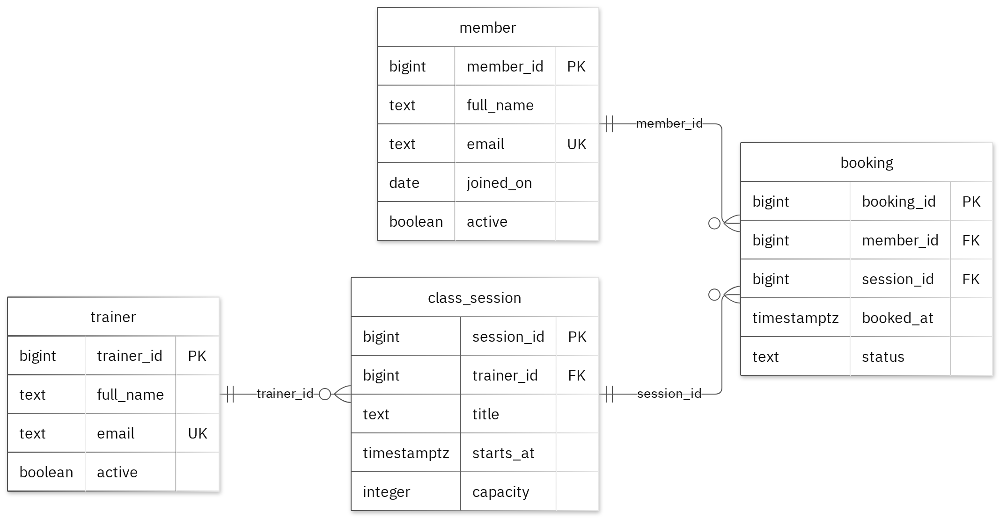

# MIT 8103 Advanced Database Systems

**Gym / Fitness Club Management** · Chimaroke Amadi · Student ID 301848183

## Case Study Overview

For this project, I designed a relational database system tailored for Gym and Fitness Club Management. Built to support club administrators, trainers, and members, the database organizes information across four core tables: member, trainer, class_session, and booking. Together, these tables streamline daily club operations by allowing staff to manage member and trainer profiles, schedule fitness classes, process member bookings, and track overall class attendance and activity.

## Portfolio 1: Database Design and Modelling

I structured the relational database across four distinct tables, using primary keys to uniquely identify records, foreign keys to maintain relationships between them, and check constraints to enforce core business rules. To prevent double-booking while still allowing members to re-register if they previously dropped out, I implemented a partial unique constraint that restricts each member to one confirmed booking per class session while excluding cancelled entries. Additionally, I included normalization examples demonstrating how the sample data progresses through 1NF, 2NF, and 3NF. During testing, the database successfully rejected all 13 deliberately invalid insert statements without corrupting or altering the valid sample data.

Figure 1. Tables, keys and relationships. PK: primary key; FK: foreign key; UK: unique value.

<!-- PAGE BREAK -->

## Portfolio 2: Query Processing and Optimisation

Next, I ran three SQL queries on the sample data to test everything out—for instance, the join query returned 1 row matching Alex Rivera with the Morning Strength class. To test how well the database scales, I ran an index comparison using 20,000 separate performance rows. With the new index in place, the median lookup time dropped noticeably from 1.097 ms to 0.182 ms, while still returning the exact same records. Checking the execution plan confirmed the query was actively using the new index, keeping in mind that these specific timings reflect this particular lookup and testing setup.

## Portfolio 3: Transactions and Concurrency

To evaluate transaction control and concurrency, I added a temporary counter to the booking table to test COMMIT, ROLLBACK, and READ COMMITTED isolation behavior. As expected, uncommitted updates remained invisible to concurrent sessions, and executing a ROLLBACK cleanly restored the previously committed value. During concurrency testing without row-level locking, two simultaneous increments resulted in a lost update, leaving the counter at 2. However, applying SELECT FOR UPDATE forced Session B to wait until Session A completed, yielding the expected final value of 3. This temporary helper column was strictly isolated to this exercise, leaving the case study's original business fields completely unchanged.

## Portfolio 4: NoSQL and Advanced Data Models

For the document-based side of the project, I stored event logs in a MongoDB collection called booking_events. I inserted two sample events and ran four queries, all of which returned the exact results I expected. To make sure data quality held up, I tested the validation rules, which successfully caught and rejected an invalid date type as well as a duplicate event ID. Storing embedded snapshots keeps related info bundled right inside each event, while the details field stays flexible enough to change based on the event type. These are just fictional test events, and PostgreSQL still handles all the core relational rules in the background.

## Repository and evidence

https://github.com/amadichimaroke530/Amadi_Chimaroke_301848183

The accompanying portfolio folders contain the complete SQL and JavaScript source code, detailed explanations, query execution plans, output result tables, and supporting screenshots.

<!-- PAGE BREAK -->

## Portfolio 5: Distributed and Cloud Database Exercise

To address system resilience, I proposed deploying three MongoDB replica members across separate failure zones. My discussion walks through how primary elections work, the role of majority write acknowledgements, potential secondary lag, and the trade-offs of sharding booking_events. I also highlighted why replication handles uptime while backups handle true data recovery, and noted that PostgreSQL needs its own dedicated availability setup. Since this follows the permitted discussion option, it outlines the architectural design without deploying a live replica set or running failover tests.

## Individual reflection

Separating member, trainer, class_session, and booking into distinct tables allows each entity to be maintained independently without duplicating details across related records. A partial unique constraint enforces at most one confirmed booking per member and class session while excluding cancelled entries, and the constraint tests validate this rule alongside required fields and foreign key links. The two-session concurrency exercise demonstrated how two sessions can read the same uncommitted state simultaneously, causing a lost update unless row-level locking is applied prior to reading so both increments are preserved. Finally, the index comparison highlighted the importance of inspecting query execution plans alongside output accuracy, showing that identical result sets can require vastly different amounts of underlying database work.

## AI-use and same-day commits declaration

I utilized GitHub Copilot and the portfolio generator to assist in preparing the database model, scripts, and written explanations. The generator executed the PostgreSQL and MongoDB exercises, verified the outputs, and captured the supporting result screenshots, while I remain fully responsible for reviewing, validating, and explaining all submitted work. Beyond these tools, the project files were developed and refined over a four-week period leading up to today's final commit to GitHub. Overall, it has been a rewarding and insightful project to build.

## References

- [PostgreSQL: constraints](https://www.postgresql.org/docs/17/ddl-constraints.html)
- [PostgreSQL: EXPLAIN](https://www.postgresql.org/docs/17/using-explain.html)
- [PostgreSQL: isolation](https://www.postgresql.org/docs/17/transaction-iso.html)
- [PostgreSQL: row locks](https://www.postgresql.org/docs/17/explicit-locking.html)
- [MongoDB: data modelling](https://www.mongodb.com/docs/manual/data-modeling/)
- [MongoDB: replication](https://www.mongodb.com/docs/manual/replication/)
- [MongoDB: sharding](https://www.mongodb.com/docs/manual/sharding/)
- [Mermaid: ER diagrams](https://mermaid.js.org/syntax/entityRelationshipDiagram.html)

